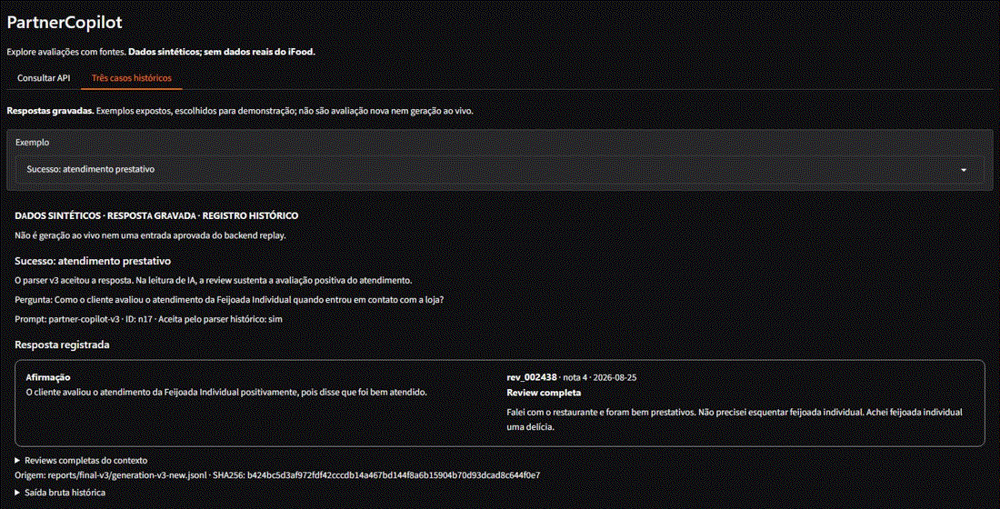

# PartnerCopilot

[](https://github.com/JoaoNordemann/partner-copilot/actions/workflows/retriever-unit.yml)

O PartnerCopilot ajuda parceiros de restaurantes a investigar atrasos, atendimento e qualidade nas avaliações dos pedidos. **Dados sintéticos, sem dados do iFood.**

| Medição | Resultado |
| --- | --- |
| Busca por restaurante | A cobertura da evidência nos cinco primeiros resultados (recall limitado@5) subiu de **25,14% para 74,65%** ao restringir a busca ao restaurante (24 perguntas sintéticas já vistas). |
| Filtro por aspecto | A proporção de posições relevantes entre os cinco primeiros resultados (precision@5) subiu de **30,83% para 37,50%**, de um teto de 45,83% (24 perguntas sintéticas já vistas). |
| Contrato de geração | O JSON v3 passou no parser em **14/27** saídas, na sessão original, ante 2/27 em texto livre (n = 27 chamadas em perguntas já vistas). A repetição NF4 aceitou 13/27. |
| Extração em e-commerce | Em avaliações de e-commerce, o modelo ajustado deixou a lista de aspectos vazia em **3/19** casos em que deveria, ante 17/19 das regras (n = 19 textos sem aspecto aplicável). |
| API real | Mediana de **24,07 s** ponta a ponta em NF4 na T4 (20 requisições com perguntas já vistas, incluindo 8 sucessos e 12 rejeições por saída fora do contrato). |

## Rodar em CPU

A demo em CPU simula uma abstenção fixa no modo padrão e mostra respostas gravadas na aba histórica. A geração ao vivo requer GPU.

Clone com `git -c core.autocrlf=false clone https://github.com/JoaoNordemann/partner-copilot.git` para preservar os arquivos de dados byte a byte no Windows. Na raiz do clone, com Python 3.12 ou 3.13 e ambiente virtual ativo:

```powershell
python -m pip install --index-url https://download.pytorch.org/whl/cpu "torch>=2.2,<3"
python -m pip install -r requirements-cpu.txt "gradio>=6,<7" "httpx>=0.27,<1"
python scripts/run_mvp.py
```

Abra a [demo](http://127.0.0.1:8000/demo/) ou a [documentação da API](http://127.0.0.1:8000/docs).
O primeiro uso baixa o encoder e monta o índice. A aba histórica inclui as avaliações completas usadas como fonte.

### Testar

Em outro terminal, na raiz do clone e com o mesmo ambiente virtual ativo:

```powershell
python -m pip install -e . --no-deps pytest pytest-cov
python -m pytest -m "not gpu"
```

## O que não funcionou

- **Com o contrato estrito, o backend real respondeu a 8 de 20 requisições.** As outras 12 retornaram HTTP 502 por falha de contrato no teste com NF4 na T4 e índice de 862 documentos. [Diagnóstico das rejeições](reports/mistral-t4-v1/README.md#diagnóstico-das-rejeições-http)
- O retry acrescentou 25 chamadas e recuperou **0/25** rejeições.
- Em `n12`, uma resposta aceita usou um elogio ao custo-benefício para afirmar que o sabor era bom. A review relatava gosto ruim no final.
- O QLoRA previu sabor ou temperatura em **87/200** textos de e-commerce. Seu treino sintético não incluía exemplos sem aspecto aplicável.

## Limitações e trabalho futuro

A geração real exige GPU e falhou no contrato em 12 de 20 requisições do teste na T4. A extração de aspectos perdeu desempenho na transferência para e-commerce. A busca usa corpus sintético e perguntas já vistas. O desempenho em avaliações reais de restaurantes segue sem medição. O próximo teste deve usar um novo conjunto anotado, com exemplos sem aspecto aplicável.

[Artigo](docs/article-outline.md) · [RESULTADOS.md](reports/final-results-v1/RESULTADOS.md) · [Adapter no Hugging Face](https://huggingface.co/jnordemann/partnercopilot-absa-qlora-v1) · [Notebook no Kaggle](https://www.kaggle.com/code/jnordemann/partnercopilot-absa-em-portugu-s?scriptVersionId=368237209) · [Container CPU](docs/docker.md)

## Demo local

O replay operacional está fora do escopo do MVP.

**Space adiado.** O MVP fica com a demo local e os registros históricos, pois a janela para publicar e validar o Space não foi confirmada.

A aba de casos históricos exibe respostas gravadas em dados sintéticos.
O GIF alterna os três casos da demo, com a falha identificada na interface.



[Captura anterior do caso n17](docs/assets/demo/n17-sucesso.jpg) ·
[Abstenção](docs/assets/demo/n20-abstencao.jpg) ·
[Falha](docs/assets/demo/n12-falha.jpg) ·
[Curadoria e decisão sobre o Space](docs/demo.md#curadoria-das-respostas-gravadas)

## Detalhes técnicos

<details>
<summary>Arquitetura, resultados adicionais e execução em Docker</summary>

FastAPI e Gradio usam um índice Chroma persistente. A ingestão valida e separa dados, divide textos longos e atualiza os documentos pelos mesmos IDs. Embeddings multilíngues e filtros recuperam o contexto. A geração v3 produz JSON e o parser confere esquema, IDs e trechos literais.

<!-- BEGIN GENERATED RESULTS -->
- RAG de reviews sintéticas, com citações verificadas e abstenção; sem dados reais do iFood.
- Retrieval: recall limitado@5 sem filtro de 0,2514 no multilíngue e 0,2583 no inglês; 4V/16E/4D em 24 perguntas respondíveis expostas.
- Geração v3: 6/9 saídas aceitas, incluindo duas abstenções; 3/4 substantivas aceitas sustentadas e pertinentes na leitura de IA.
- Retry descartado: 25 chamadas extras, 0 rejeições recuperadas; formato válido não garante resposta correta.
- Evidência limitada por corpus conhecido, amostras pequenas e revisão humana assistida.

[Resultados, tabelas e limitações](reports/final-results-v1/RESULTADOS.md).
<!-- END GENERATED RESULTS -->

Em T4 de 16 GB, o Mistral 7B em 4 bits usou **4,53 GiB de pico alocado** e respondeu em **5,64 s** (mediana, n = 9, conjunto originalmente limpo). Em FP16, coube com **14,16 GiB de pico alocado** e mediana de **9,07 s** no mesmo conjunto. [Comparação na T4](reports/mistral-t4-v1/README.md)

O container CPU com backend `fake` retornou HTTP 200 em `/health` e `/ask` em Ubuntu no GitHub Actions. O caminho GPU está **não testado em container**. [Docker](docs/docker.md)

As regras e partes do pipeline foram escritas com assistência de IA. O autor revisou os resultados.

</details>

[API](docs/api.md) · [Testes](docs/testing.md) · [Decisões](docs/decisions.md) · [Versão v0.2](docs/releases/v0.2-aspects.md) · [Status do estudo](docs/study-status.md) · [Notebook ABSA](https://www.kaggle.com/code/jnordemann/partnercopilot-absa-em-portugu-s?scriptVersionId=368237209)
